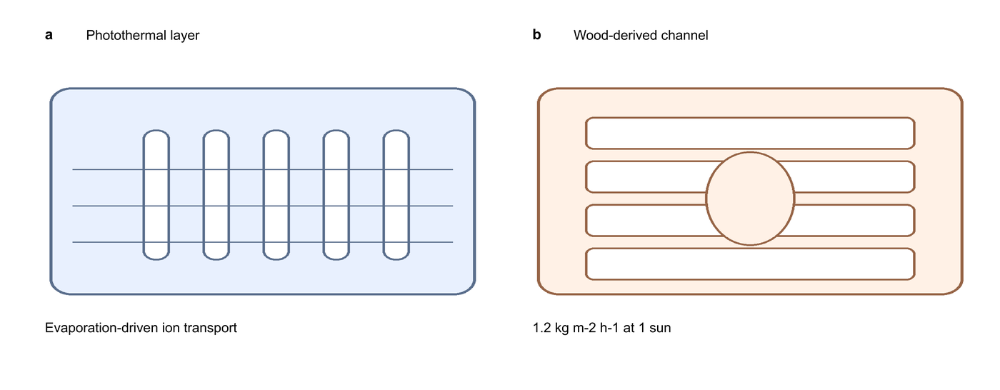

# `ppt-paper-figures` 技能

[English](README_EN.md)


一句话：**AI 只负责画素材，PPT 负责成图**——把"AI 画素材、自己在 PPT 里拼接"这套做法固化成可执行流程，并且用脚本在交付前卡住重叠、字号过小和出界三类致命问题。



上面这张图就是这套流程导出的结果：素材是本地画的替代品，所有文字都是 PPT 里的矢量文字，导出后 600 dpi、无重叠、字号按最终印刷尺寸换算达标。

## 适合用它做什么

- 综述、论文、基金申报书里的机制图、示意图、图形摘要、多栏拼版图。
- 手上没有专业绘图能力，但需要"能过审稿人眼"的配图：素材交给 AI，版式和标注自己控。
- 交付前需要一份客观质检报告，而不是靠肉眼扫一遍。
- 想让配图可被反复修改：六个月后要改一个标签，PPT 主稿还能直接改，AI 素材也留有 prompt 可重生成。

不适合：由数值数据画统计图（用 `nature-figure`）；只要 AI 出机制图、不做版式与质检（用 `biorender-mechanism-figures`）。

## 核心分工

PPT 是可编辑主稿，AI 只出"无文字素材"。文字、数字、单位、图注、箭头、比例尺、面板字母全部在 PPT 里用矢量文字完成。

这条规则带来四个硬约束：AI 素材里不允许出现任何文字、数字、单位；素材只作视觉示意，不得当作实验数据；图中每个数字都要能追溯到自己的数据或引用来源；最终导出矢量 PDF 加 600 dpi PNG。

## 工作流

1. 先定结论：这张图要证明哪一句话，分几栏，阅读顺序如何。
2. 先定画布：最终印刷宽度和栅格决定一切，幻灯片尺寸按最终比例设置。
3. 逐张生成无文字素材，一张素材一个 prompt，坏一张只重出一张。
4. 逐张检查素材：出现任何文字、水印、色标数字、乱码伪文字，直接重出。
5. 在 PPT 里拼版，叠加矢量文字、箭头、比例尺、面板字母。
6. 导出矢量 PDF 与 600 dpi PNG。
7. 跑质检门，修完再按最终印刷尺寸目视过一遍。

## 质检门

```bash
python3 scripts/figure_qa.py figure.pptx --target-width-mm 180 --min-pt 5 --allow-mm2 0.5
```

脚本检查四件事：文字与文字、文字与图像的重叠面积（mm²，最终印刷尺寸下，允许 0.5 mm² 的边框接触）；每个文字在最终印刷尺寸下的字号是否低于 5 pt；字体是否落在允许集合内（Arial / SimSun / Songti SC）；以及是否有形状跑出画布。有阻断性问题时返回非零退出码，可以直接当交付闸门用。

真跑一次的效果（完整报告见 [examples/demo-qc-report.md](examples/demo-qc-report.md)）：

```text
FAIL overlap: 2
  - text-text overlap 716.128 mm2: "1.2 kg m-2 h-1 at 1 sun" x "1.2 kg m-2 h-1 at 1 sun"
  - text-image overlap 812.902 mm2: "Photothermal layer" x "(picture)"
FAIL text below the print floor: 1
  - 1.86 pt on paper (3.5 pt in deck): "1.2 kg m-2 h-1 at 1 sun"
BLOCKING
```

那个 3.5 pt 的标注，在 13.33 英寸幻灯片上按 180 mm 印刷宽度换算后只剩 1.86 pt——这就是"屏幕上看着挺好、印出来看不见"的典型来源。

## 字体与配色

英文与数字统一 Arial，中文在 Windows 用 SimSun、在 macOS 用 Songti SC，同一张图不混用两种西文字体。正文字号按最终印刷尺寸 7 pt 为目标、5 pt 为下限。一套配色用到底，兼顾色盲可读，并且用位置或形状区分，保证黑白打印也能看懂。

## 导出

```bash
python3 scripts/export_figures.py figure.pptx --outdir build --dpi 600 --target-width-mm 180
```

有 LibreOffice 时自动把 pptx 转矢量 PDF，再用 PyMuPDF 按目标 dpi 渲染 PNG，并报告每页实际物理尺寸；没有 LibreOffice 时明确报错，不会偷偷给出一张低分辨率位图。也可以直接用 PowerPoint 导出 PDF 与 600 dpi PNG，保持同名文件即可。

## 安装

```bash
git clone https://github.com/HUC-he/ppt-paper-figures.git \
  ~/.codex/skills/ppt-paper-figures
```

或在 Codex 里说"用 `$skill-installer` 安装 `HUC-he/ppt-paper-figures`"，等价命令：

```bash
python3 ~/.codex/skills/.system/skill-installer/scripts/install-skill-from-github.py \
  --repo HUC-he/ppt-paper-figures --path . --name ppt-paper-figures
```

## 依赖

Python 侧：`python-pptx`（读质检）、`Pillow`（示例素材）、`pymupdf`（PNG 导出）。IDE 之外不需要任何付费工具；LibreOffice 只在自动导出时需要，装不上也能用 PowerPoint 手动导出。

## 目录结构

```text
ppt-paper-figures/
|-- SKILL.md                        主入口：分工、工作流、质检门、红线
|-- references/
|   |-- asset-prompts.md            无文字素材的 prompt 骨架与检查清单
|   |-- layout-and-typography.md    画布、栅格、字号换算、配色与线型
|   `-- export-and-qa.md            导出、质检、以及如何读懂一次失败
|-- scripts/
|   |-- figure_qa.py                重叠 / 字号 / 字体 / 出界 质检门
|   `-- export_figures.py           pptx → 矢量 PDF → 600 dpi PNG
|-- examples/
|   |-- build_demo_figure.py        生成演示用双栏图（含 --defect 注入缺陷）
|   `-- demo-qc-report.md           真实质检报告与修复过程
|-- tests/test_figure_qa.py         11 项行为测试
|-- assets/preview.png              README 首图（由示例图导出后缩放）
|-- manifest.yaml                   按阶段加载依赖的声明
`-- agents/openai.yaml              UI 元数据
```

## 红线

绝不把 AI 素材当实验数据、显微照片或测量结果；绝不让素材里带文字、数字与单位；绝不为了好看去拉伸、镜像或修补真实图像而改变其含义；绝不放行没通过重叠与最小字号质检的图；绝不在 prompt 文件、脚本或 PPT 里写入任何 API key 或私有端点凭据。

## 联系与关键词

作者 UUNICE（GitHub [@HUC-he](https://github.com/HUC-he)）。问题与改进建议：shiyuhe1@163.com。

关键词：论文配图、科研绘图、综述配图、机制示意图、图形摘要、PPT 拼图、配图质检、投稿图导出、figure assembly、PowerPoint figure workflow、graphical abstract、publication figures、overlap check、600 dpi export。

## 许可

MIT，见 [LICENSE](LICENSE)。
