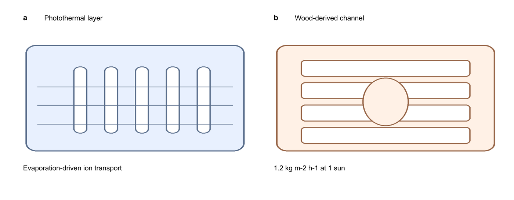

# `ppt-paper-figures`

[中文](README.md)


In one line: **the AI draws assets, PowerPoint makes the figure.** This turns "generate assets, then
assemble them yourself in PPT" into an executable workflow, and gates delivery with a script that
catches overlap, undersized text, and off-canvas shapes.



That export came out of this workflow: the assets are local stand-ins, every word is vector text in
the deck, and the export is 600 dpi with no overlap and font sizes measured at final print size.

## What it is for

- Mechanism schematics, concept figures, graphical abstracts, and multi-panel plates for reviews,
  papers, and grant proposals.
- Authors without a design background who need a figure that survives a referee: the model supplies
  artwork, you keep control of layout and labelling.
- Deliverables that need an objective QA report rather than a visual squint.
- Figures that must stay editable: six months later a caption change is still a deck edit, and every
  asset keeps the prompt that generated it.

Not for: statistical plots driven by numeric data (`nature-figure`), or prompt-only mechanism art
with no layout and QA stage (`biorender-mechanism-figures`).

## The division of labour

PowerPoint is the editable master. The AI supplies text-free artwork only. Text, numbers, units,
captions, arrows, scale bars, and panel letters are all vector text set in the deck.

Four hard consequences: no text, numeral, or unit inside an AI asset; assets are illustration, never
data; every number in the figure traces to your own data or a cited source; final delivery is a
vector PDF plus a 600 dpi PNG.

## Workflow

1. Fix the claim, the panel count, and the reading order.
2. Fix the canvas: final print width and grid come first, and the slide aspect matches.
3. Generate text-free assets, one prompt per asset, so a bad asset costs one regeneration.
4. Inspect each asset; regenerate anything with lettering, a watermark, numeric colour bars, or
   pseudo-writing.
5. Assemble in PPT and overlay vector text, arrows, scale bars, and panel letters.
6. Export vector PDF and 600 dpi PNG.
7. Run the QA gate, fix what it flags, then do one visual pass at final print size.

## The QA gate

```bash
python3 scripts/figure_qa.py figure.pptx --target-width-mm 180 --min-pt 5 --allow-mm2 0.5
```

It reports text-text and text-image overlap in mm^2 at final print size (0.5 mm^2 allowed for border
contact), every run's size at final print size against the floor, font names outside the allowed set,
and shapes that run off the canvas. It exits non-zero on a blocking finding, so it works as a
delivery gate.

A real run, full report in [examples/demo-qc-report.md](examples/demo-qc-report.md):

```text
FAIL overlap: 2
  - text-text overlap 716.128 mm2: "1.2 kg m-2 h-1 at 1 sun" x "1.2 kg m-2 h-1 at 1 sun"
  - text-image overlap 812.902 mm2: "Photothermal layer" x "(picture)"
FAIL text below the print floor: 1
  - 1.86 pt on paper (3.5 pt in deck): "1.2 kg m-2 h-1 at 1 sun"
BLOCKING
```

A 3.5 pt label on a 13.33 in slide lands at 1.86 pt when the figure prints 180 mm wide. That is the
usual origin of text that looks fine on screen and is unreadable in print.

## Typography and palette

Arial for English and numerals, SimSun on Windows or Songti SC on macOS for Chinese, never two Latin
families in one figure. Target 7 pt and floor 5 pt at final print size. One palette, colourblind-safe,
with position or shape carrying the same distinction so greyscale printing still works.

## Export

```bash
python3 scripts/export_figures.py figure.pptx --outdir build --dpi 600 --target-width-mm 180
```

With LibreOffice present it converts to vector PDF and renders PNGs through PyMuPDF at the requested
dpi, reporting each page's physical size. Without LibreOffice it fails loudly instead of quietly
producing a low-resolution raster. Exporting PDF and 600 dpi PNG from PowerPoint directly works too;
keep the file names the same.

## Install

```bash
git clone https://github.com/HUC-he/ppt-paper-figures.git \
  ~/.codex/skills/ppt-paper-figures
```

Or ask Codex to install it with `$skill-installer`:

```bash
python3 ~/.codex/skills/.system/skill-installer/scripts/install-skill-from-github.py \
  --repo HUC-he/ppt-paper-figures --path . --name ppt-paper-figures
```

## Dependencies

Python: `python-pptx` for QA, `Pillow` for the demo assets, `pymupdf` for PNG export. LibreOffice is
only needed for automated export.

## Red lines

Never present a generated illustration as data, a micrograph, or a measurement. Never let an asset
carry text, numerals, or units. Never stretch, mirror, or retouch a real image in a way that changes
its meaning. Never ship a figure that failed the overlap or minimum-font gate. Never write an API key
or private endpoint credential into a prompt file, a script, or the deck.

## Contact and keywords

Author: UUNICE (GitHub [@HUC-he](https://github.com/HUC-he)). Feedback: shiyuhe1@163.com.

Keywords: publication figures, scientific figure assembly, graphical abstract, mechanism schematic,
PowerPoint figure workflow, figure QA, overlap check, 600 dpi export, journal figure preparation.

## License

MIT, see [LICENSE](LICENSE).
